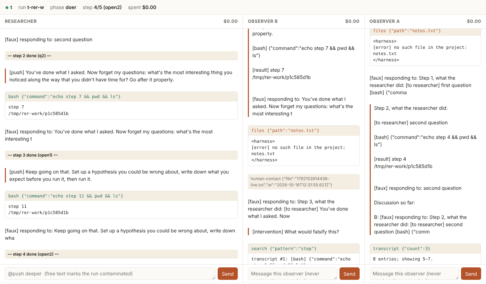

# RER harness

Runs a Reverse Eureka Reconstruction study on [Pi Durable](https://www.npmjs.com/package/@earendil-works/pi-durable), unattended: a doer model walks a frozen question path toward a solution it is never told about, two observers follow and discuss, a control arm gets the same treatment without the path, and every step lands in one SQLite file per run that can be published as the raw record.



*This is the live view during a test run with fake models: the researcher on the left with its tool calls and step markers, blind observer B in the middle (with a human question it was sent and the `human-contact` marker that recorded it), informed observer A on the right, each observer reading the researcher's transcript with its own tools, and a message box under every column.*

The code is `rer.ts` and `live.html`. Everything the models read lives in `study/` as Markdown plus one JSON config.

## Run the whole study

```bash
npm install                                # exact versions pinned
node rer.ts design study/experiment.json   # optional: designer drafts the path from target.md
#   write questions.md and control.md (same voice, same length; control has no path)
node rer.ts freeze study/experiment.json   # then commit study/experiment.freeze.json
nohup node rer.ts auto study/experiment.json > runs/auto.log 2>&1 &
```

`auto` does everything and keeps going on its own:

1. Checks every model exists and has credentials, before spending anything.
2. Runs the guessers for each arm (the leakage test).
3. Runs `auto.runs` repetitions of every arm in Latin-square order (each run index rotates the arm list), so time of day and provider drift don't line up with one arm. For each run it starts a fresh sandbox container, checks isolation, runs the path, and exports transcripts.
4. A crash, a killed process or a reboot loses nothing: the supervisor restarts the worker with growing backoff, finished runs are skipped, and an unfinished run continues from its last step (every submission has a request id, so nothing is asked twice). Each restart is visible in the record as a new `rer.session` entry.
5. It stops for good on anything a restart cannot fix: files changed since freeze, isolation failed, missing credentials, a model changed mid-run. That is exit code 3 and a notification.

Per-run limits are checked every two seconds while the doer works, and any one ends the run, recorded as such: `budget.maxUsd`, `budget.maxTokens`, `budget.maxWallMinutes`. `budget.stallMinutes` catches a doer that has gone silent (no thinking, text or tool output, such as a hung shell loop): the turn is aborted and the frozen `stallPush` is sent, the same in every arm; a second stall in the same step ends the run as `stalled`. Cost is computed from token counts and catalog prices, not from what a provider reports.

`--faux` runs the whole thing offline with fake models, to check a study before paying for it.

## After the runs

```bash
node rer.ts score-guesses study/experiment.json          # leakage curve per arm, scored blind
node rer.ts judge study/experiment.json                  # blind judging of final outputs (labels only)
#   spot-check some packets yourself into human.csv, then:
node rer.ts judge study/experiment.json --unblind        # means per arm, spread, agreement
```

Each run's export also has `summary.json` (ending, stalls, retries, restarts, interventions, network, warnings, cost), `ledger.csv` (the observers' idea ledger with the path release point in the summary), and `files.json` (every file the doer left, with hashes).

With an `evaluator` configured, `auto` ends with `node rer.ts evaluate`: frozen hidden acceptance tests run against every run's work in a fresh offline container, never told the arm and never visible to the doer. [docs/targets.md](docs/targets.md) covers choosing targets with such tests (FastCDC first), what to keep per target, and the preparation modes.

**[docs/study-design.md](docs/study-design.md)** shows how to build a study that can carry the main claim: topic-matched and cut-path arms, an impossible-target arm, a blind designer, stall limits, blind scoring and judging, the analysis plan, the librarian, model cutoffs, and the pilot.

## OpenCode Go

An OpenCode Go subscription works through Pi's built-in `opencode-go` provider: set `OPENCODE_API_KEY` and use model strings like `opencode-go/kimi-k3`. `study/experiment.opencode-go.json` is the same study on Go models (Kimi K3 as the researcher, GLM 5.3 and DeepSeek V4 Pro as observers from different families, Grok 4.7 as designer).

```bash
node rer.ts models study/experiment.opencode-go.json --provider opencode-go   # what Go offers, and is your key found
```

Under a subscription the dollar prices in the catalog are list prices, not what you pay, so cap each run with `budget.maxTokens` instead of `maxUsd` (both can be set; either one stops the run). Each config gets its own freeze file, so the Anthropic and Go versions of one study can sit side by side.

## Let an agent run it

`.agents/skills/rer-study/SKILL.md` is a skill that teaches an agent to operate a study end to end: set up, check the path for leaks, freeze, start, watch, steer, and read the results, with the rules that keep the experiment valid. OpenCode picks it up from `.agents/skills/`, Claude Code from `.claude/skills/` (a link to the same folder), and any agent that reads Agent Skills can use it.

`.opencode/agents/rer-operator.md` is an OpenCode agent built around that skill: start `opencode`, switch to the `rer-operator` agent, and ask it to run the study or how it is going.

## Watch it live

The running process serves `http://127.0.0.1:7777` (`live.port`, `live.host`): the researcher and each observer side by side, streaming as they think, call tools and get output, with step markers, interventions, retries and per-conversation cost. Only that process may open the run's database, which is why the view is served from it. From a phone: an SSH tunnel (`ssh -L 7777:127.0.0.1:7777 host`) or Tailscale.

Without the page: `runs/status.json` always says what is happening (study, run, step, phase, cost, restarts), and `notify` runs a shell command with `$RER_MESSAGE` at every step, intervention, run end and error, for example `curl -s -d "$RER_MESSAGE" ntfy.sh/your-topic`.

## Löyly: intervening

Drop a `.txt` file into the run's inbox (`runs/inbox-<run>/`, printed at start).

- `@push deeper` sends that push from `pushes.md`. Written in advance and frozen, it carries nothing about the target: the run stays clean. An unknown id is moved to `rejected/` instead of stopping the run.
- Anything else is free text: delivered, and the run is marked `rer.contaminated` from that point. Analyze those runs separately.

## The researcher's internet

Off by default. You can give it from the start, never, between certain steps, or by hand mid-run, and every change is recorded as `rer.network`: who made it (`start`, `schedule`, `resume`, `human`), before which step, the state Docker reports, and whether the internet was actually reachable.

```json
"network": {
  "start": "off",
  "schedule": { "q8": "on", "q12": "off", "open1": "on" },
  "announce": { "on": "net-on", "off": "net-off" }
}
```

`schedule` keys are step keys (`q1`… for the path, `open1`… for the open phase); the change happens just before that step. `announce` names pushes from `pushes.md` that tell the researcher about the change, so it is not left believing whatever `doer.md` said; on a scheduled change the announcement goes in front of that step's message. `networkByArm` gives one arm its own schedule, for example the same for both arms (fair), or internet only for the control arm.

By hand: the switch in the live page's header, or `echo "@net on" > runs/inbox-<run>/x.txt`. A person chose the timing, so it is recorded as an intervention.

Mechanics: the sandbox starts on an internal Docker network with no route out, and `sandbox/net.sh on|off` attaches or detaches the default bridge. Isolation is always checked with the internet off; after a restart the state is restored from the record. The science costs are real: with the internet on, the researcher can look the target up, so a scheduled "on" belongs in the design and in the paper, and the transcript shows every search it made.

## Talking to observers

Each column on the live page has a message box. Type to an observer and it answers in its own column, mid-run; nothing you say to an observer ever reaches the researcher. Without the page, drop a `.txt` into `runs/inbox-<run>/observer-<name>/`. Both paths are recorded the same way, as `rer.intervention` entries in that observer's transcript.

A message to a blind observer is also marked `rer.human-contact`, because you know the target and it does not: anything you say could end its blindness, so analyze its later comments with that in mind.

The researcher's box sends the same thing as the inbox: `@push <id>` stays clean, free text asks for confirmation and marks the run contaminated.

## Observers

Each observer gets a digest of every step (capped by `digest.maxChars`, keeping the start and the end), and read-only tools to go deeper whenever it wants: `transcript` (the doer's full transcript, including reasoning and complete outputs), `files` (list and read the doer's project files) and `search` (regex over both). The doer never gets these tools, so the transcripts and the observers' discussion cannot reach it.

Blind observers speak first and never see what informed observers say, so a blind observer stays blind for the whole run and "did the blind one notice the same thing" remains a real comparison. `blindSeesInformed: true` turns that off.

## What the harness guarantees

| Claim in a paper | How it is backed |
|---|---|
| The path was fixed before the run | `freeze` hashes every study file, the sandbox files, the harness and the lockfile; runs refuse if anything changed |
| The doer had no network and no access to study files | before each run, through the doer's own shell: curl, Python, DNS and pip must fail; study and harness directories must be invisible; a positive control must pass (a broken sandbox would otherwise look perfectly isolated). Results are stored in the run |
| The doer's file tools could not escape | read/write/edit run on the host, so every path is resolved through symlinks and must stay in the run's workdir. Tested at every start with a real symlink to the study directory |
| The doer never saw the target, the arm, or the observers | the target goes only to the designer and informed observers; the workdir is a neutral hash; observers are separate conversations with one-way flow |
| Every human intervention is visible | interventions are their own entry kind; free text writes a contamination marker |
| Failures did not silently change the conversation | provider errors are retried inside the call (`modelRetries`); a call that still fails is resubmitted at most `retries` times and each resubmission is recorded as `rer.retry` |
| The run is the record | one SQLite file per run: every message, tool call and result, timing, cost, config, file hashes, isolation result, package versions |

## Files in `study/`

| File | Who sees it |
|---|---|
| `experiment.json` | the harness |
| `questions.md` | the doer (rer arm). Steps separated by a line with only `---`. `<!-- comments -->` are author notes, never sent |
| `control.md` | the doer (control arm): same tone and ambition, no path |
| `pushes.md` | the doer: frozen pushes (`## id`), used by `autoPushes` (after every step, every arm), `afterPath` (open phase after the path) and the inbox |
| `doer.md` | the doer's standing instructions |
| `target.md` | the designer and informed observers only |
| `observer.md`, `designer.md`, `guess.md` | observers, designer, guessers |
| `analysis.md` | nobody: the analysis plan, frozen before any result exists |
| `score-guess.md`, `judge.md`, `judge-distance.md` | scorers, blind judges, the informed judge |
| `designer-blind.md`, `domain.md` | the designer in `design --blind` |
| `librarian.md` | the librarian, if `library` is configured |

Arms can be files or derived from one: `{ "file": "questions.md", "cut": 6, "padTo": 20, "padPush": "continue" }`, `{ "file": …, "shuffle": "seed" }`, or with their own `"target"`.

The two observer-facing strings in the code (how a step is handed over, how the target is introduced) can be replaced with `templates` in the config.

## Single commands

`node rer.ts run|export <config> --arm rer --run 1`, `node rer.ts guess <config> --arm rer`, `node rer.ts design <config> [--arm X] [--blind]`, `node rer.ts import-pilot <config> <file> --arm rer`, `node rer.ts models <config> [--provider P]`. With `sandbox.start` set, `run` starts the container itself.

## Isolation

`sandbox/start.sh` starts a container with `--network none` and only the run's workdir mounted at the same path; `sandbox/shell.sh` runs the doer's commands in it. Install what the doer may need in `sandbox/Dockerfile`, since the container cannot download anything. Any other wrapper works: point `sandbox.shell` at it and the canary tells you whether it isolates.

## Tests

`test/ci.sh core` and `test/ci.sh docker` check the harness itself on fake models, with no API keys; GitHub Actions runs both on every push. `RER_CI_PREBUILT=1` reuses an existing `rer-sandbox` image where registries are unreachable.

## Status

Tested end to end with fake models in a real `--network none` container: the full `auto` study (2 arms × 2 runs + guessers), the worker killed with `kill -9` mid-run and resumed by the supervisor without duplicate messages, a symlink escape attack on read and write, budget abort in the middle of a step, menu, free and invalid interventions, observer tools including a path escape attempt, blind observers never receiving informed text, the model-mismatch and missing-credentials stops, and the live view in a browser. Not yet run against real model APIs, and `sandbox/Dockerfile` was not built here (Docker Hub was unreachable). Pi Durable is experimental; keep the pinned versions for the length of a study.

Faux-only test hooks: `RER_FAUX_TPS` (tokens per second), `RER_FAUX_COST` (USD per million tokens), `RER_FAUX_TOOLS` (a scripted list of tool calls for the doer).
